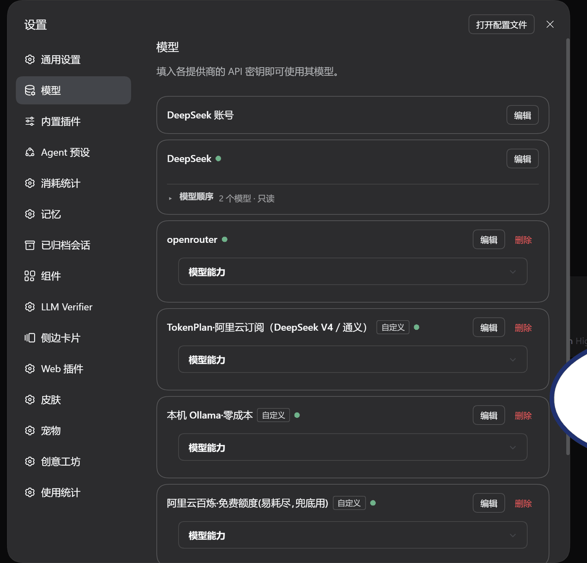
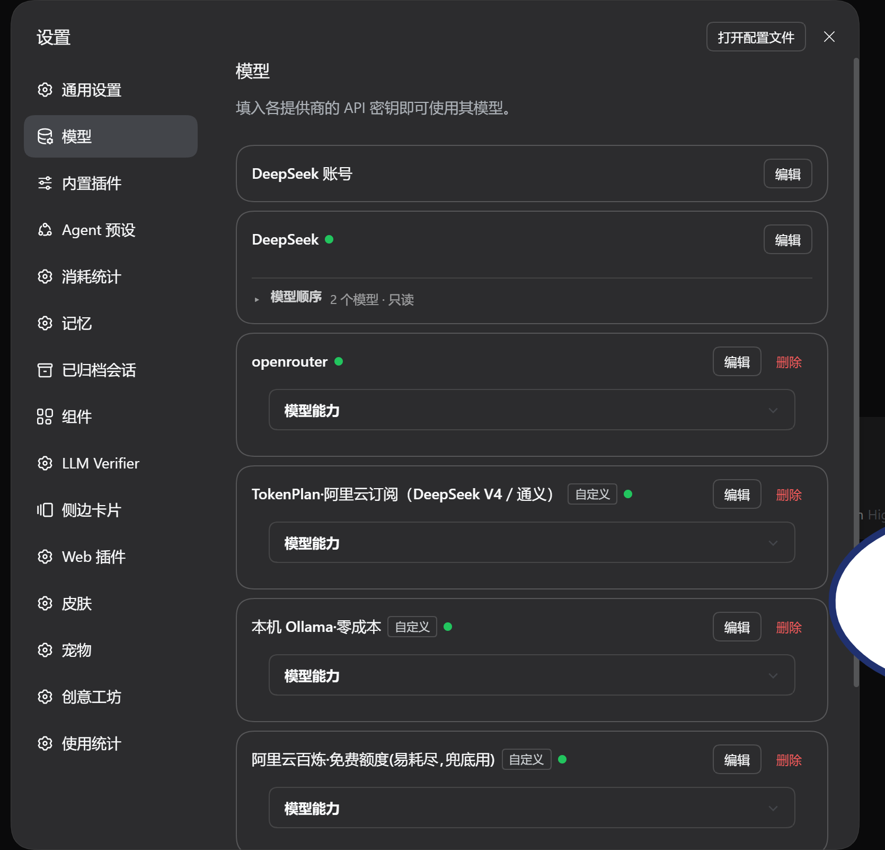

# dsh-model-priority

自定义模型 / 提供方的排列顺序：拖一下把常用的模型顶到选择器最前面。



*真机录屏（隔离 dsh web 实例，真实界面）：装上前是宿主原顺序；装上后模型页的提供方卡片里多出「模型顺序」扩展区，点开即展开，拖拽保存后选择器按新顺序返回。*



宿主的模型选择列表按适配器注册顺序排，常用的模型常常排在后面；这个插件让你在模型设置页里拖一下，把它顶到前面去。

## 长什么样

两个入口：

- **侧边栏「模型排序」页**（需 dsh-better-sidebar）：下拉选提供方 → 分组模型列表拖拽，覆盖 `llm-pi-ai` 家族的自定义提供方。
- **设置 → 模型 的 DeepSeek 卡片内扩展区**（keyed 槽 `settings.models.provider-card`，key=`llm-deepseek`）：内置 DeepSeek 家族在卡片内拖拽。

默认模型带 ★ 固定不可拖；「恢复默认」回到宿主原顺序。百炼一个路由上百个模型，列表按 qwen/glm/kimi 家族分组各自折叠。

## 装 / 卸

```bash
dsh plugin --profile web add "<本仓目录，或 git 地址>"
dsh plugin --profile web remove dsh-model-priority
```

- **装完要重启 `dsh web`**：服务端半边（注册路由、挂钩）与浏览器侧半边（进 boot 图的 combo）都是启动时装配的。顺序文件每次调用现读，改它不用重启。
- 拿不到 slots 时卡片格不挂；没装 better-sidebar 时侧边栏页 warn 跳过、卡片格照常 —— 那几条 HTTP 路由任何情况下都可用。

## 它会动你的哪些文件

| 文件 | 什么时候 | 怎么收拾 |
|---|---|---|
| `~/.dsh/model-order.json` | 每次点「保存」 | 删掉就回默认 |
| `~/.dsh/profiles/<p>/cordis.patch.yml`（0.1.7 线起的真源） | 点「保存」并同步宿主时 | 写之前先备份成 `cordis.patch.yml.bak-<ISO 时间戳>` |
| `~/.dsh/settings.yaml`（0.1.5 线） | 同上 | 同样先备份；内容没变就不写也不备份 |
| `~/.dsh/model-priority-proxy.json` | 只有启用轮换代理才会创建 | 删掉即停用 |

为什么要写盘：宿主按 `models` 数组的**顺序**渲染列表（设置页与选择器都看它）。只在读的时候排序，会出现「设置页一个顺序、选择器另一个顺序」，两套来源必然打架。本包两代形状都认，有回归测试盯着（`test/settings-source.test.mjs`）。

## 它怎么生效（摘要）

- 排序来源 = **settings 真源里该提供方 `models` 数组的物理顺序**（文本块级重排）。
- **默认模型钉位**：`agent-default-model` 声明的那个模型写回时强制钉回原位。
- **双端镜像**：写活动层的同时镜像到其它带 `llm-pi-ai` 的 profile 层（web↔desktop），`config: { mirror: false }` 可关。
- 服务端半边在 `ctx.llm` 的**实例属性**上包一层，让 `listProviders()` / `listConfigurableProviders()` / `listModels(provider)` 按这份顺序返回；**稳定排序**，没被点过名的条目保持相对位置。

实现取舍、三条必须守住的契约（同步返回 / 形参个数 / 只重排不改条目）、以及为什么改实例属性同时覆盖直调与远端两条路，见 [docs/internals.md](docs/internals.md)。

## 路由（裸路由，自判来源）

| 路由 | 作用 |
|---|---|
| `GET /dsh-model-priority/state.json` | 目录快照 + 当前顺序 + 挂钩状态 |
| `GET /dsh-model-priority/provider-models?route=<route>` | 某路由当前的模型 id 顺序 |
| `GET /dsh-model-priority/suggest?route=<route>&mode=capability\|cheap\|quota` | 建议顺序 |
| `PUT /dsh-model-priority/order.json` | 保存顺序文件（`{"reset":true}` 清空） |
| `POST /dsh-model-priority/settings-order` | 按给定顺序重排当前生效真源里该提供方的 `models` |

这些路由注册在 `ctx.webServer` 上，是**裸路由**（宿主鉴权只覆盖 `client-connection` 的通道与首页），所以本包自己判来源：Host 必须 loopback 或宿主登记的权威、`sec-fetch-site` 不是 `cross-site`、有 `Origin` 时主机名与 Host 一致；跨域一律 403，响应不带 `Access-Control-Allow-Origin`。本机 shell 里 `curl` 照常可用。

## 边界

- 只在 `ctx.llm` 真的暴露上述方法的宿主版本上生效；挂不上时 `state.json` 的 `hook.ok` 为 `false` 并带原因，页面顶部会显示，顺序文件仍可编辑。
- 可拖拽并写回的是你自己配置的提供方（`llm-pi-ai` 家族）；内置 DeepSeek 卡片里显示为只读 —— 那份清单不在本机配置真源里，插件不碰。
- 不改宿主任何一行代码，但会按你的操作重排当前生效真源里对应提供方的 `models` 数组。
- 靠改配置里 provider 的**键顺序**来排序不可靠：`registrationFacts` 会对 provider 做 sort 判断"是否变化"，单纯调键序不触发 replace，运行中不立刻生效，而且被 replace 的那批路由会被挪到 Map 末尾。
- 某个适配器不支持列举模型时，那个提供方下面是空的 —— 这是适配器能力边界，不是排序没生效。

## 它不管什么

- **只管「列表顺序」**：不做请求路由、不做故障转移、不做用量统计。那三件事各有人在管，塞进一个插件最容易互相打架。
- 上游没有「调整模型顺序」的入口（2026-09-10 提过 discussion，至今零回复）。这个插件补的就是那一格。

## 自检

```bash
npm test
```

五个脚本合计 54 项，都不启动 dsh、不碰 3080 端口（数据层 / 服务端八条路由端到端 / 浏览器侧 bundle / 配置真源两代 / 读侧失败态）。逐脚本说明见 [docs/internals.md](docs/internals.md#自检都验了什么)。

## 附带的轮换代理（默认关）

包内另有一个小的本机转发层：把某提供方的 `baseURL` 指到本插件的 `rotate` 端点，在 `.credentials.yaml` 的多把 key 之间依次试（429 / 额度尽才换）。默认不开、无页面入口，只能走 HTTP 逐个 route 启用；路径里带 32 字节随机 token，不知道 token 一律 403。细节见 [docs/rotate-proxy.md](docs/rotate-proxy.md)。

## 更新日志

见 [CHANGELOG.md](CHANGELOG.md)。
